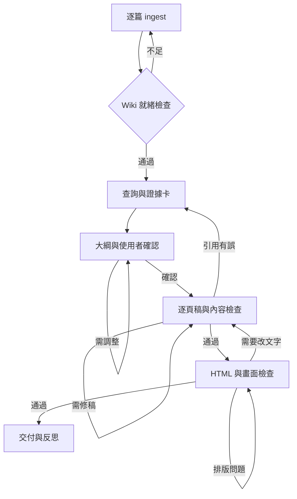

# 工作流程：Wiki 到教學 HTML

執行模式：AI 依節點規則執行、以檔案交接，使用者在大綱關卡確認。這是文件式工作流程規格，目前尚未建立自動調度所有節點的程式；已可執行的部分包括 Wiki／大綱／HTML 結構檢查、HTML 產生及翻頁索引測試。

| 節點 | 輸入 | 輸出 | 通過條件與退回方式 |
|---|---|---|---|
| A：來源 ingest | 原文、來源清單、既有 Wiki | 來源摘要、概念／比較、索引、紀錄 | 來源可讀、主張可定位；失敗先補來源或回看原頁 |
| B：Wiki 就緒 | Wiki、來源清單 | lint 與來源覆蓋紀錄 | 至少五份不同來源完成 ingest，結構與內容核對通過；不足退 A |
| C：查詢與證據卡 | Wiki 目錄、相關頁面 | evidence 中帶來源的教學證據卡 | 教學問題有支持；不足退 A 或補查 Wiki |
| D：教學大綱 | 已確認的證據卡 | slides/outline.md | 符合初學者、10–12 頁規劃；由使用者確認，需修正時留在 D |
| E：逐頁稿與內容檢查 | 大綱、證據卡 | slides/drafts.md、審查報告 | 各頁主張有依據；錯誤退 E，證據有誤退 C |
| F：HTML 與畫面檢查 | 已通過逐頁稿 | slides/deck.html、實際檢查紀錄 | 文字一致、引用有效、無溢出、翻頁可操作；排版錯誤退 F，文字需改退 E |
| G：交付與反思 | 成品、紀錄 | 成果連結、真實反思 | 沒有假裝審查或重跑；列出限制與未通過事項 |

## Graph

## Loop 與停止條件

- 來源摘要與語意核對最多三輪；不能讀取的原文不靠模型背景知識補寫。
- 逐頁稿最多三輪，只修報告指出的頁面；仍不通過則停止並列問題。
- HTML 畫面修正最多三輪；縮字或刪改內容時退回逐頁稿，不偷偷改已確認文字。
- 獨立新對話語意審查為可選；本次依使用者選擇跳過，不阻擋發布，仍如實記錄未執行。
- 各節點保存輸入、輸出、檢查結果及修正次數。需回到上游時只重跑受影響的下游。

## 目前的實際前移

第一次處理 DDPM 時遇到 PDF 抽取公式編碼；來源可讀性檢查已設在 A 節點摘要之前。這是第一階段的實際觀察。

第三階段另外發現兩個排版樣式命名衝突，已修正，並把根頁面樣式命名規則加入 HTML 結構檢查，讓同類衝突在視覺檢查之前被發現。列印檢查已執行；瀏覽器實際操作與獨立語意審查仍待完成，F 節點尚未全面通過。詳見 [本輪紀錄](../reports/deck-stage3.md)。
